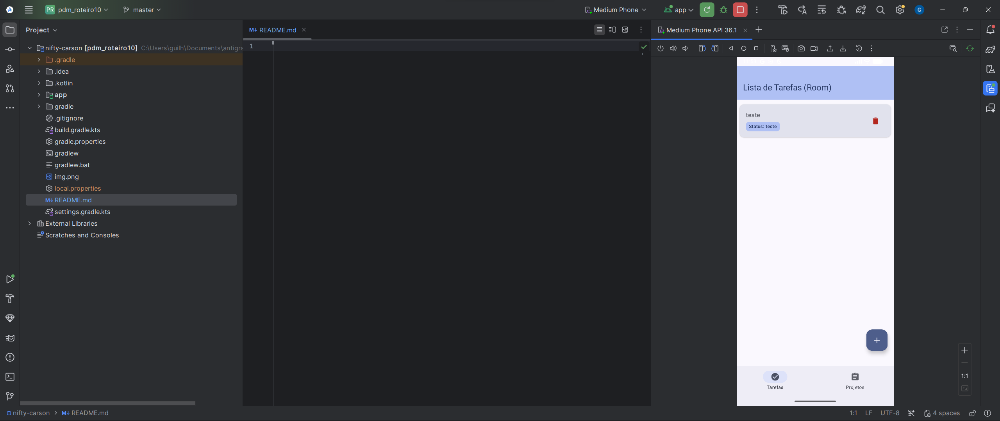

# Roteiro da Atividade Prática 11



## PDM - Roteiro 11: Estruturação de Projeto e Injeção de Dependências com Hilt

Projeto desenvolvido para a disciplina de Programação para Dispositivos Móveis (PDM). Esta etapa realizou a reestruturação arquitetural completa da aplicação e a introdução da biblioteca **Dagger Hilt** para Injeção de Dependências (DI), desacoplando a camada de dados, camada de negócios/apresentação e interface de usuário.

---

## 🎯 Objetivo da Atividade
- **Estruturação do Projeto**: Aplicação das boas práticas de arquitetura recomendadas pelo Google (Clean Architecture / Modern Android Architecture), organizando o código em camadas bem definidas (`data`, `di`, `ui`).
- **Injeção de Dependências com Hilt**:
  - Configuração do plugin e dependências do Hilt com KSP no Gradle.
  - Criação da classe `Application` com `@HiltAndroidApp`.
  - Configuração da `MainActivity` com `@AndroidEntryPoint`.
  - Injeção automática de instâncias do Room (`AppDatabase`, DAOs) via módulos Hilt (`@Module`, `@Provides`).
  - Criação da camada de repositório (`Repository Pattern`) com interfaces e implementações vinculadas via `@Binds`.
  - Injeção de dependências no `AppViewModel` via `@HiltViewModel` e `@Inject constructor`, eliminando a necessidade de estender `AndroidViewModel` e o acoplamento direto com o `Context`.
  - Fornecimento do ViewModel na UI utilizando `hiltViewModel()`.

---

## 🏗️ Arquitetura e Estrutura de Diretórios

A estrutura de arquivos foi dividida em pacotes por responsabilidade:

```
app/src/main/java/com/example/pdm_roteiro10/
├── MainActivity.kt                     # Activity única anotada com @AndroidEntryPoint
├── PdmApplication.kt                   # Application anotada com @HiltAndroidApp
│
├── data/                               # Camada de Dados
│   ├── local/
│   │   ├── dao/
│   │   │   ├── ProjetoDao.kt           # Interface DAO para operações de projetos
│   │   │   └── TarefaDao.kt            # Interface DAO para operações de tarefas
│   │   ├── database/
│   │   │   └── AppDatabase.kt          # RoomDatabase abstrato
│   │   └── entity/
│   │       ├── Projeto.kt              # Entidade Room 'projetos'
│   │       └── Tarefa.kt               # Entidade Room 'tarefas'
│   └── repository/                     # Padrão Repository
│       ├── ProjetoRepository.kt        # Interface do repositório de projetos
│       ├── ProjetoRepositoryImpl.kt    # Implementação injetada com ProjetoDao
│       ├── TarefaRepository.kt         # Interface do repositório de tarefas
│       └── TarefaRepositoryImpl.kt     # Implementação injetada com TarefaDao
│
├── di/                                 # Módulos de Injeção de Dependências (Hilt)
│   ├── DatabaseModule.kt               # Fornece AppDatabase, TarefaDao e ProjetoDao (Singleton)
│   └── RepositoryModule.kt             # Vincula (@Binds) implementações às interfaces de repositório
│
└── ui/                                 # Camada de Interface do Usuário (Jetpack Compose)
    ├── components/                     # Componentes visuais reutilizáveis
    │   ├── LoadingIndicatorScreen.kt   # Indicador de carregamento
    │   ├── ProjetoItem.kt              # Card de item de projeto com exclusão
    │   └── TarefaItem.kt               # Card de item de tarefa com exclusão
    ├── navigation/
    │   └── AppNavigation.kt            # Gerenciamento de rotas e NavHost com hiltViewModel()
    ├── screens/
    │   ├── projetos/
    │   │   ├── FormProjetoScreen.kt    # Tela de criação e edição de projeto
    │   │   └── ListaProjetosScreen.kt  # Tela de listagem de projetos
    │   └── tarefas/
    │       ├── FormTarefaScreen.kt     # Tela de criação e edição de tarefa
    │       └── ListaTarefasScreen.kt   # Tela de listagem de tarefas
    ├── theme/                          # Tema Material 3
    │   ├── Color.kt
    │   ├── Theme.kt
    │   └── Type.kt
    └── viewmodel/
        └── AppViewModel.kt             # @HiltViewModel injetado com os Repositórios
```

---

## ⚙️ Tecnologias Utilizadas
- **Linguagem**: Kotlin 2.0.21
- **Toolkit UI**: Jetpack Compose (BOM 2024.09.00, Material 3)
- **Injeção de Dependências**: Dagger Hilt 2.51.1 + Hilt Navigation Compose 1.2.0
- **Processamento de Anotações**: KSP 2.0.21-1.0.28
- **Persistência Local**: Room 2.6.1 (SQLite) com Kotlin Coroutines & Flow
- **Navegação**: Navigation Compose 2.7.7
- **Build System**: Gradle 8.13, AGP 8.13.2, JDK 21 (JBR 21)
- **Testes Unitários**: JUnit 4 com testes dos repositórios via Fakes

---

## 🧪 Testes
Foram adicionados testes unitários em `RepositoryTest.kt` validando o comportamento de inserção e busca reativa das implementações de `TarefaRepository` e `ProjetoRepository`, comprovando a testabilidade proporcionada pelo desacoplamento via injeção de dependências.

Executar os testes:
```bash
./gradlew testDebugUnitTest
```
